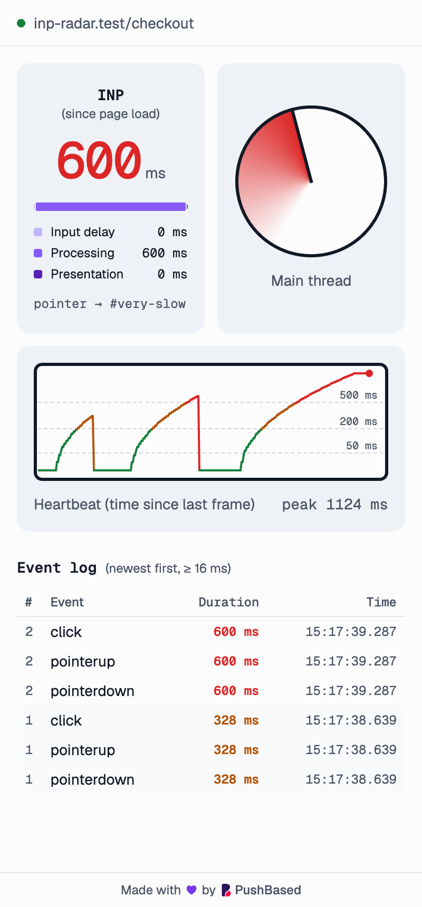
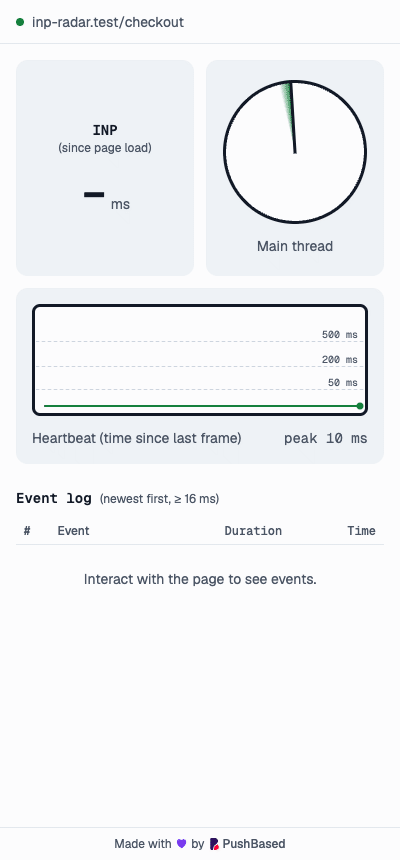

<h1>
  <picture>
    <source media="(prefers-color-scheme: dark)" srcset="design/logo/logo-dark.svg">
    
  </picture>
</h1>

[](https://github.com/push-based/inp-radar/actions/workflows/ci.yml)

A click can get a poor INP without doing anything slow itself. If a recurring
timer or a tracking script has the page's main thread blocked when the click
lands, the click waits until that work is done, and the wait counts as input
delay.

INP Radar is a Chrome extension that shows when a page's main thread is
blocked, live, in a side panel next to the page. Open any site, leave it alone,
and watch: background work shows up as spikes, often on a regular beat. Those
are the moments when a user's click would get a poor INP.

[Try it on the demo page](https://push-based.github.io/inp-radar/demo/).

<p align="center">
  <picture>
    <source media="(prefers-color-scheme: dark)" srcset="docs/screenshots/sidepanel-dark.png">
    
  </picture>
</p>

## Two causes of a slow interaction

When we debug poor INP, the cause is almost always one of these:

1. **The interaction is expensive.** The event handler, and the render it
   triggers, keep the main thread busy before the page can paint a response.
2. **The main thread is already blocked.** Recurring timers, tracking scripts
   and other background work run long tasks. The interaction itself may be
   cheap, but it queues behind them.

You see the first cause as soon as you click and measure. The second is easy to
miss, because it only hurts when a click lands during a block. A single test
click usually lands between blocks and looks fine.

The panel shows both:

- **Radar and heartbeat trace.** Both draw the time since the page last rendered
  a frame. They reveal background blocks without any interaction (cause 2).
- **INP and its breakdown.** The panel splits the interaction that set INP into
  input delay, processing and presentation, and names the target element. High
  input delay means the click waited behind other work (cause 2). High
  processing or presentation means the interaction itself is expensive
  (cause 1).
- **Event log.** Every interaction of 16 ms or more, newest first.

## The demo page

The [demo page](https://push-based.github.io/inp-radar/demo/) reproduces both
causes. With the extension loaded (see [Development](#development)), open the
page and open the side panel on its tab.

1. **A recurring timer.** A `setInterval` callback runs a 300 ms long task every
   3 s. Don't touch anything: the wedge grows and the trace spikes on every run,
   at a steady interval. You can change the block length and the interval, or
   turn the timer off.
2. **An expensive interaction.** With the timer off, click the button that runs
   250 ms of work. Input delay stays low and almost all of the interaction is
   processing.
3. **A cheap interaction, idle and blocked.** Click the counter button between
   blocks and it's fast. Click it during a block and it waits for the long task
   to finish. That wait is input delay, and it makes a cheap click slow.

The page is a single static file, [`demo/index.html`](demo/index.html), with no
dependencies.

## Using it with a DevTools trace

To fix an INP problem, you record a trace in the Chrome DevTools Performance
panel. INP Radar tells you when to record and when to click:

- **Catch a block.** Watch the radar until you see the spikes, then record a
  trace across one. The trace shows the work that blocked the main thread.
- **Wait for idle.** Watch for a quiet stretch where the trace stays flat, then
  interact. Nothing else is running, so the trace shows the interaction's own
  cost.

The panel shows when the main thread is blocked, not which script blocked it.
Script attribution, using the Long Animation Frames API, is planned. Until it
ships, the DevTools trace is where you find the culprit.

## How it works

```
┌──────────── page tab ─────────────┐        ┌──── side panel ────┐
│ content script (page main thread) │  port  │ sidepanel/         │
│  • PerformanceObserver('event')   │ ─────▶ │  • INP + breakdown │
│  • onINP (web-vitals/attribution) │        │  • radar + pulse   │
│  • rAF heartbeat                  │        │  • event log       │
└───────────────────────────────────┘        └────────────────────┘
```

- `src/entrypoints/content.ts` measures inside the page. It buffers INP and
  event entries, so a panel opened late still shows history. The heartbeat only
  runs while a panel is connected.
- `src/entrypoints/sidepanel/` connects to the active tab with `tabs.connect`,
  follows tab switches and navigations, and renders.
- `src/shared/protocol.ts` defines the messages between the two.

### The radar

The radar comes from Phil Walton's [INP demo](https://chrome.dev/inp-demo/)
([source](https://github.com/GoogleChromeLabs/web-perf-demos/tree/main/inp-demo)).
There it animates on the page's main thread, so it freezes when the page is
blocked. Copied into the side panel as-is, it would never freeze, because the
panel runs in a different process.

So the content script sends a heartbeat on every page animation frame. The panel
spins the sweep on its own clock and draws the wedge as the time since the last
heartbeat. When the page is blocked, no frames run and the wedge grows. It turns
amber past 200 ms and red past 500 ms (the INP thresholds), then catches up once
frames resume.

### The heartbeat trace

`sidepanel/pulse.ts` draws the same signal as an ECG-style strip on a canvas. It
sweeps left to right in sync with the radar. Each column plots the time since
the page's last frame on a square-root scale. Reference lines sit at 50 ms (the
long-task threshold), 200 ms and 500 ms.

A healthy page draws a flat green line. A block draws a spike that climbs for as
long as it lasts and drops when frames resume, so you can compare several blocks
side by side. A recurring timer shows up as spikes at a steady interval. The
readout shows the peak in the current sweep.

Here the page blocks its main thread for 300, 600 and 1500 ms on three clicks:

<p align="center">
  <picture>
    <source media="(prefers-color-scheme: dark)" srcset="docs/screenshots/sidepanel-dark.gif">
    
  </picture>
</p>

## Development

Built with [WXT](https://wxt.dev) and vanilla TypeScript.

```bash
pnpm install
pnpm dev        # launches Chrome with the extension loaded, hot reloading
pnpm build      # production build in .output/chrome-mv3
pnpm compile    # type-check
pnpm test       # unit tests (Vitest); `pnpm test:watch` to re-run on change
pnpm e2e        # build, then run the Playwright end-to-end tests
pnpm demo       # serve the demo page at http://localhost:5173
pnpm screenshots # build, then re-render the README screenshots
```

Unit tests sit next to the code as `*.test.ts`. They run in jsdom with WXT's
Vitest plugin, which provides the `@/` aliases and a fake `browser` API.

The end-to-end tests in `e2e/` load the built extension into Playwright's
Chromium (run `pnpm exec playwright install chromium` once). A test can't open
the side panel, so the tests load `sidepanel.html` in a tab and then switch to
the test page. The panel follows it, as it would the active tab.

The screenshots in `docs/screenshots/` come from `tools/screenshots/capture.ts`,
which uses the same setup and clicks the test page on a fixed schedule. Joining
the GIF frames needs Python 3 with Pillow.

To load a build manually, open `chrome://extensions`, enable Developer mode,
click **Load unpacked** and pick `.output/chrome-mv3`. Click the toolbar icon to
open the side panel.

### Publishing

The **Publish** workflow submits a build to the Chrome Web Store. It only runs
by hand: bump `version` in `package.json`, then go to **Actions → Publish → Run
workflow**. Tick **dry-run** to check the credentials without uploading.
**STAGED_PUBLISH** holds the version after review until you publish it from the
developer dashboard.

The store API can't create an item, so the first version is uploaded by hand in
the [developer dashboard](https://chrome.google.com/webstore/devconsole), along
with the listing and privacy details. After that, the workflow needs a
`chrome-web-store` environment in the repository settings with:

| Name                                  | Kind     | Value                                                  |
| ------------------------------------- | -------- | ------------------------------------------------------ |
| `CHROME_EXTENSION_ID`                 | variable | The item ID from the dashboard                         |
| `CHROME_PUBLISHER_ID`                 | variable | The publisher ID from the dashboard's account page     |
| `CHROME_SERVICE_ACCOUNT_CLIENT_EMAIL` | variable | The email of a Google Cloud service account            |
| `CHROME_SERVICE_ACCOUNT_PRIVATE_KEY`  | secret   | The `private_key` from that service account's JSON key |

The service account needs the Chrome Web Store API enabled in its Google Cloud
project, and its email added to the publisher in the dashboard's account
settings.

## Limitations

- Tabs that were open before the extension was installed need a reload.
- `chrome://` pages and the Chrome Web Store can't be measured.
- Only the top frame is measured.
- The event log only lists events of 16 ms or more (the Event Timing minimum).
- The panel shows when the main thread is blocked, not which script blocked it
  (see [Using it with a DevTools trace](#using-it-with-a-devtools-trace)).

## License

[Apache-2.0](https://github.com/push-based/inp-radar/blob/main/LICENSE). The
radar and side panel styles are adapted from Google's INP demo, also
Apache-2.0. See
[NOTICE](https://github.com/push-based/inp-radar/blob/main/NOTICE).
